<div align="center">

  <!-- PILIH SALAH SATU: Gunakan ./assets/banner.svg (animasi) atau ./assets/banner.png (statis) -->
  

  <br /><br />

  <!-- TYPING SVG (EMERALD MATRIX THEME) -->
  <a href="https://github.com/Jonatanarya">
    
  </a>

  <br />

  <!-- BADGES NAVIGATION -->
  <p align="center">
    <a href="https://github.com/Jonatanarya">
      
    </a>
    <a href="https://t.me/synj0">
      
    </a>
    <a href="https://github.com/Jonatanarya?tab=repositories">
      
    </a>
    
  </p>

</div>

```yaml
0xarsant@sec-ai-lab:~$ neofetch --config ./identity.conf
────────────────────────────────────────────────────────────────────────
  alias       :: 0xarsant (Jonatanarya)
  role        :: Individual Security Researcher & AI Agent Enthusiast
  domains     :: [ "Autonomous AI Agents", "Vuln Research", "DevSecOps", "Web3" ]
  stack       :: [ "Python", "TypeScript", "Rust", "Go", "Solidity" ]
  philosophy  :: "Zero-trust by design. Self-hostable. Bring your own API key."
  status      :: Actively hunting bugs & orchestrating LLM agent workflows
────────────────────────────────────────────────────────────────────────
